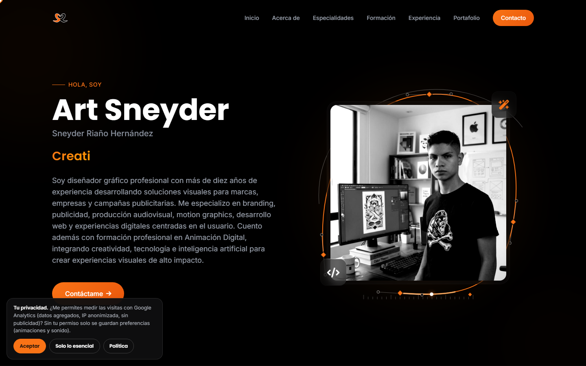

# Sneyder Riaño · Portfolio & CV

My personal site: portfolio, interactive résumé (with an ATS-friendly version) and digital business cards.

**[🔗 Live demo](https://sneyder.netlify.app)** · [🇪🇸 Leer en español](#-español)

   



## ✨ Highlights

- Single-page portfolio with project showcase and contact
- Interactive résumé plus an ATS-optimized version and PDF exports
- Digital business card generator with export script
- SEO basics: sitemap, robots, custom 404 and security headers

## 🚀 Run locally

No build step. Open `index.html` in a browser, or serve the folder:

```bash
npx serve .
```

## 👤 Author

Designed and developed by **Sneyder Riaño**, graphic designer & web developer in Bogotá, Colombia.
[Portfolio](https://sneyder.netlify.app) · [GitHub](https://github.com/artsneyderdiseno-droid)

> Brand names, logos and photos belong to their respective owners and are shown with permission as portfolio work. The code is shared for review purposes; please don't reuse brand assets.

---

## 🇪🇸 Español

Mi sitio personal: portafolio, hoja de vida interactiva (con versión ATS) y tarjetas de presentación digitales.

**[Ver en vivo](https://sneyder.netlify.app)**

**Lo más destacado**

- Portafolio de una página con proyectos y contacto
- Hoja de vida interactiva, versión ATS y exportación a PDF
- Generador de tarjetas digitales con script de exportación
- SEO básico: sitemap, robots, 404 propia y cabeceras de seguridad

**Cómo ejecutarlo**

Sin compilación. Abre `index.html` en el navegador o sirve la carpeta con `npx serve .`

Diseño y desarrollo: **Sneyder Riaño** · Bogotá, Colombia.
